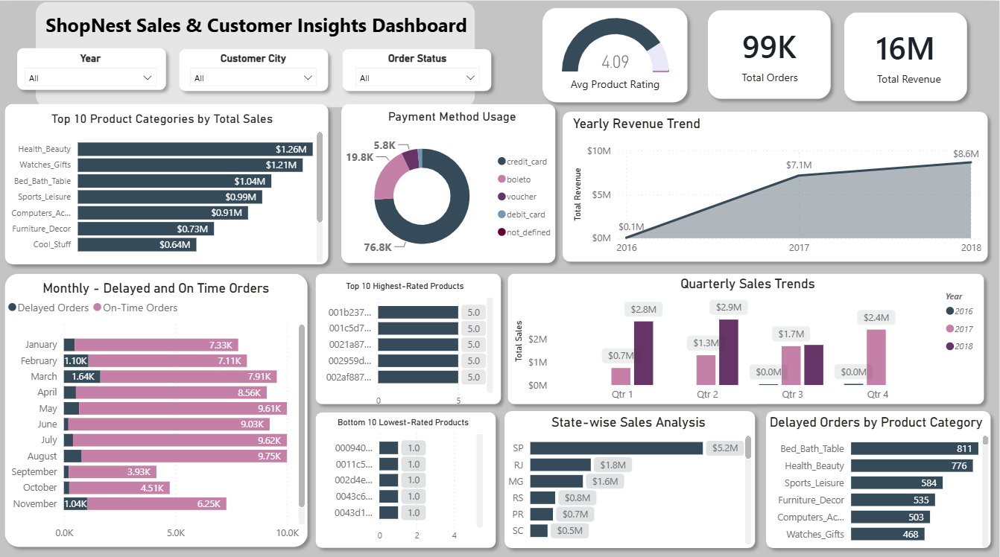

# ShopNest Store | Sales & Customer Insights Dashboard

One-page interactive Power BI dashboard analyzing sales, delivery performance, payments, ratings, and regional trends for a retail store.

## Overview

This project turns retail transaction data into insights through an interactive Power BI dashboard. It answers eight business questions covering sales, delivery delays, customer ratings, payment preferences, and time-based trends.

## Dataset

- Source: Skillovilla — ShopNest project dataset
- Scope: 99,441 orders across 2016-2018 (2018 is a partial year)

## Tools & Technologies

Power BI, DAX, Power Query, Data Modeling (Star Schema)

## Headline KPIs

| Metric | Value |
|---|---:|
| Total Revenue | $15,843,553 |
| Total Orders | 99,441 |
| Average Product Rating | 4.09 / 5 |

## Business Questions

1. Top 10 product categories by total sales
2. Product categories with the most delayed orders
3. Delayed vs on-time orders month by month
4. Distribution of payment methods
5. Highest and lowest rated products
6. States generating the highest sales
7. Quarterly sales patterns
8. Year-over-year revenue change

## Data Model

Star-schema-style model with order and order-item data connected to dimension tables for Customers, Products, Sellers, Geolocation, and Product Category Translation. Order reviews are used for rating analysis, with DAX `TREATAS()` transferring filter context between order items and reviews.

## Key Findings

**Sales by category:** Health & Beauty (1,258,681), Watches & Gifts (1,205,006), and Bed/Bath/Table (1,036,989) lead revenue.

**Delivery delays:** Bed/Bath/Table has the most delayed orders (811), followed by Health & Beauty (776), Sports & Leisure (584), and Computers & Accessories (503). Two of the top three sales categories are also the biggest delay sources, so delivery fixes there would have the most impact.

**Payments:** Credit card dominates at 73.9%, followed by Boleto (19.0%), Voucher (5.6%), and Debit Card (1.5%).

**Regions:** São Paulo leads with 5,202,955 in sales, far ahead of Rio de Janeiro (1,824,093) and Minas Gerais (1,585,308). Sales are heavily concentrated in one state.

**Trends:** Quarterly sales grew steadily through 2017, from 741,960 in Q1 to 2,418,405 in Q4.

## Interactive Filters

Slicers for Year, Customer City, and Order Status.

## Limitations

- 2018 is a partial year and 2016 has limited data, so year-over-year comparisons need care.
- Product names aren't in the data, so products are identified by ID.
- Many products share the same ratings, which affects top-10 and bottom-10 lists.
- Seasonal explanations for delays are hypotheses, not confirmed causes.

## Project Files

- `Dashboard- ShopNest Sales & Customer Insights.pbix`: Power BI dashboard (open in Power BI Desktop)
- `Dashboard_Report.docx`: detailed project report
- `dashboard.png`: dashboard screenshot (place it in the repository root)

## Author

**Suraguru** | Data Analyst (Excel, SQL, Python, Power BI)

I turn operational data into clear, actionable insights using analytics and visualization tools.

[LinkedIn](https://www.linkedin.com/in/suraguru)

